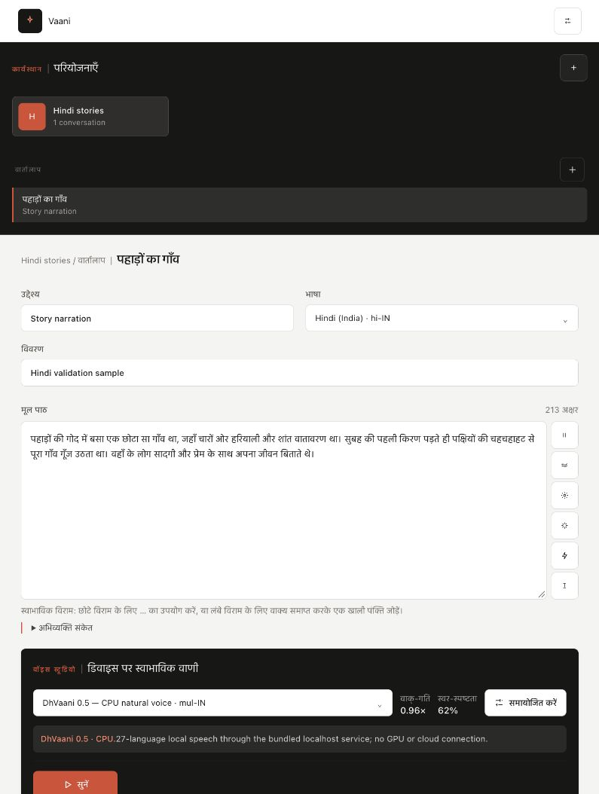

# TTS

An offline-first multilingual text-to-speech workspace. No text is sent to a remote service.



## Run locally

```sh
bun install --frozen-lockfile
bun run setup:cpu
bun run dev:cpu
```

Open the local URL shown by Vite (http://127.0.0.1:5176). The included Hindi validation file is at `public/audio/hindi-sample.wav`.

### Windows

Install Bun 1.4.4 or newer, then run the same commands in PowerShell or Windows Terminal:

```powershell
bun install --frozen-lockfile
bun run setup:cpu
bun run dev:cpu
```

Non-technical users can instead double-click `run.bat`. It installs the locked
JavaScript dependencies when needed, prepares the local CPU service on first run,
starts Vaani, and opens the workspace in the default browser. Bun and Python must
already be installed.

The one-time setup requires internet access for Python packages. Afterwards, the application, DhVaani weights, and inference remain local and need no network connection. No GPU, CUDA, WebGPU, Bash, Unix path, or native compiler is required.

## Support

- Hindi offers Kokoro Alpha, Priyamvada/Piper, and DhVaani 0.5.
- English uses Kokoro Heart
- Indian English can also use DhVaani. DhVaani covers the Indian languages listed in the application through an INT8 ONNX CPU service.

## Performance markup

The compact controls beside **Original text** insert markup that is parsed before synthesis; the tags are never spoken.

```text
[calm] पहाड़ों की गोद में बसा एक छोटा सा गाँव था…
[pause=500]
[warm, emphasis=हरियाली] जहाँ चारों ओर हरियाली थी।
[reflective] वहाँ के लोग… सादगी से जीवन बिताते थे।
```

- `[pause=500]` inserts exactly 500 ms of silence in generated neural WAV files. Values are limited to 4,000 ms.
- `[calm]`, `[warm]`, `[reflective]`, and `[energetic]` adjust only synthesis controls supported by the selected engine. Priyamvada and DhVaani receive pace, expression, and variation changes; Kokoro receives segment-level pace and punctuation shaping; system voices receive segment-level rate changes.
- `[emphasis=हरियाली]` surrounds the matching word with model-readable em-dash phrasing.
- Punctuation remains important: commas create phrase boundaries, `…` suggests reflection, `—` adds emphasis, and `?` encourages a rising question ending.

DhVaani's reference clip still determines its underlying voice, pitch range, rhythm, and emotional character. Markup shapes a performance within that voice; it cannot turn a monotonous reference into a fully expressive actor.

The bundled Priyamvada and DhVaani weights are intended here for personal or non-commercial use. Kokoro model assets are Apache-2.0. See `THIRD_PARTY_NOTICES.md`.

## Code structure

- `VaaniApp` owns UI events and rendering.
- `WorkspaceStore` owns project state and browser persistence.
- `SpeechService` exposes neural and system playback through an async generator.
- `dhvaani_server.py` isolates CPU-heavy multilingual ONNX inference from the browser UI.
- `WaveformPlayer` renders local audio, seeking, and segment-bounded playback with WaveSurfer.js.
- `view.js` contains pure HTML rendering.
- `tts-settings.js` validates and clamps user-tunable synthesis settings.

Public classes and synthesis methods include English and Hindi JSDoc.
